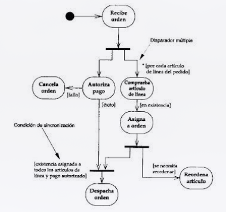

## UNIVERSIDAD NACIONAL DE SAN AGUSTIN

#### FACULTAD DE INGENIERÍA DE PRODUCCIÓN Y SERVICIOS ESCUELA PROFESIONAL DE INGENIERÍA DE SISTEMAS

JESUS MARTIN SILVA FERNANDEZ M en C CIENCIAS DE LA COMPUTACION

# GUÍA DE LABORATORIO

#### CALIDAD DE SOFTWARE

#### SEMESTRE 8

#### COMPETENCIAS

Construye responsablemente soluciones siguiendo un proceso adecuado llevando a cabo las pruebas ajustada a los recursos disponibles del cliente.. Cm

Curso: Sistemas Distribuidos Página:

# Laboratorio

### Dimensionamiento: Puntos de Función

### I OBJETIVOS

Evaluar, analizar y utilizar adecuadamente alguna herramienta y/o metodología para el dimensionamiento temporal en etapa temprana con fines de aceptabilidad

### II TEMAS A TRATAR

- **Metodología de Dimensionamiento**
- **Artefactos UML**

### III MARCO TEÓRICO

- **Metodología de Dimensionamiento** COSMIC-FFP (Common Software Measurement International Consortium-Full Function Points) nace en el año 1997 de la mano de 5 autores: Alain Abran (École de technologie supérieure – Universidad de Québec), Jean-Marc Desharnais (Software Engineering Laboratory in Applied Metrics-SELAM), Serge Oligny (Bell Canada), Denis StPierre (DSA Consulting Inc.) y Charles Symons (Software Measurement Services Ltd.), con el objetivo de focalizar el análisis de Puntos de Función al Software de Aplicaciones de Negocio (o Management Information Systems, MIS) y Software de Tiempo Real. Más adelante, en 2002, es aceptado cómo estándar internacional ISO/IEC 19761, consolidándose como un método de referencia para medir el tamaño funcional del software. Es inevitable, no obstante, que, pese a ser reconocido como estándar internacional de medición, se busque la comparación con otros estándares "equivalentes" como IFPUG, NESMA o MKII. A lo largo de este artículo, se buscará por tanto establecer los principios del método COSMIC-FFP partiendo de la comparación con el más extendido de todos ellos, IFPUG.vistas, como punto de partida para la preparación de un SDD, y una capacidad genérica para definir un nuevo diseño puntos de vista ampliando así la expresividad de un SDD para sus partes interesadas
- **COCOMO** Una de las tareas de mayor importancia en la administración de proyectos de software es la estimación de costos. **M en C JESUS MARTIN SILVA FERNANDEZ**

Si bien es una de las primeras actividades, inmediatamente posterior al establecimiento de los requerimientos, se ejecuta regularmente a medida que el proyecto progresa con el fin de ajustar la precisión en la estimación. La estimación de costos de software tiene dos usos en la administración de proyectos: ! Durante la etapa de planeamiento: Permite decidir cuantas personas son necesarias para llevar a cabo el proyecto y establecer el cronograma adecuado. Para controlar el progreso del proyecto: Es esencial evaluar si el proyecto está evolucionando de acuerdo al cronograma y tomar las acciones correctivas si fuera necesario. Para esto se requiere contar con métricas que permitan medir el nivel de cumplimiento del desarrollo del software. En el ámbito de la ingeniería de software, la estimación de costos radica básicamente en estimar la cantidad de personas necesarias para desarrollar el producto. A diferencia de otras disciplinas de la ingeniería, en las cuales, el costo de los materiales es el principal componente a ser estimado. La estimación de costos de software posibilita relacionar conceptos generales y técnicas del análisis económico en el mundo particular de la ingeniería de software. Aunque no es una ciencia exacta no podemos prescindir de ella puesto que hoy en día un error en las predicciones puede conducir a resultados adversos. Es importante reconocer la fuerte relación entre costo, cronograma y calidad

### ACTIVIDADES

1. Procedimiento

- Ejecutar ejercicios resueltos y propuestos
- Escriba un reporte sobre las tareas realizadas y resultados.
- Escriba sus conclusiones

2. Agenda:

| Instalación herramienta | 20 minutos |
| ----------------------- | ---------- |
| Implementación caso     | 70 minutos |
| Generación de reporte   | 15 minutos |

3. Estructura de reporte
   I. Objetivo II. Descripción del procedimiento realizado en la práctica III. Resultados obtenidos IV. Análisis de resultados
   V. Conclusiones
   El envío al drive compartido del reporte, incluye código generado por alumno.

### V EJERCICIOS RESUELTOS

1. Utilizando el ejemplo resuelto de Ejemplo.doc, utilizar los datos y verificar resultado, en la herramienta Excel, utilizando la metodología NESMA -Puntos de Función <u>[https://sourceforge.net/projects/functionpoints/](https://sourceforge.net/projects/functionpoints/)</u> -COCOMO: <u>[https://techno-soft.com/wp-content/uploads/2018/11/QMS-Cocomo-II-Estimation-](https://techno-soft.com/wp-content/uploads/2018/11/QMS-Cocomo-II-Estimation-)</u> <u>Sheet-Template.xls</u>

### VI EJERCICIOS PROPUESTOS

1. Dimensionar la aplicación descrita en el Anexo 1. Calcular el valor en soles y el tiempo de entrega considerando 1 y 3 personas.
2. Compare los valores de ambas aplicaciones y determine valores aproximados de PF para un tamaño pequeño, mediano y grande.
3. Modifique valor de PF que debería ajustar con la experiencia y como sería el procedimiento para hacerlo.
4. Realizar el dimensionamiento en COCOMO, wine y COSMIC. Revise, verifique resultados y construya tabla comparativa.

### VII CUESTIONARIO

a) Que resuelve conocer dimensionamiento temprano de proceso de construcción de software?
b) Indique la ventaja de usar la metodología NESMA?
c) Es confiable el dimensionamiento COCOMO, porque?

### VIII BIBLIOGRAFÍA

- <u>[https://leda-mc.com/wp-content/uploads/2016/11/De_IFPUG_a_COSMIC.pdf](https://leda-mc.com/wp-content/uploads/2016/11/De_IFPUG_a_COSMIC.pdf)</u>
- <u>[https://riunet.upv.es/bitstream/handle/10251/109927/PSC9691917_TFM_1532552620](https://riunet.upv.es/bitstream/handle/10251/109927/PSC9691917_TFM_1532552620)</u> <u>188720975771735607734.pdf?sequence=1&isAllowed=y</u>
- <u>[https://blogadmi1.files.wordpress.com/2010/11/cocom0llfull.pdf](https://blogadmi1.files.wordpress.com/2010/11/cocom0llfull.pdf)</u>

#### ANEXO 1

#### Descripción

Se ha de realizar el diagrama de casos de uso de un cajero automático en el que se pueden realizar las operaciones siguientes:

- Retirar efectivo.
- Ingresar o depositar efectivo.
- Hacer transferencias.
- Obtener información de nuestra cuenta: movimientos, saldo, etc.
  Para realizar cualquiera de las operaciones el cajero automático ha de validar la tarjeta y la clave que introduce el usuario. Se debe considerar la interacción que tiene con el cajero, a la hora de realizar estas operaciones, el banco y el consorcio. Llamaremos consorcio a la red de cajeros automáticos a las que se suscriben los bancos para que los cajeros automáticos realicen las operaciones

#### Diagrama

#### Descripción

Realiza el diseño de una aplicación para la gestión de pedidos. La aplicación deberá:

- manejar clientes (se guarda su nombre, dirección, teléfono y e-mail), que pueden realizar pedidos de productos, de los cuales se anota la cantidad en stock. Un cliente puede tener una o varias cuentas para el pago de los pedidos. Cada cuenta está asociada a una tarjeta de crédito, y tiene una cierta cantidad disponible de dinero, que el cliente debe aumentar periódicamente para poder realizar nuevos pedidos.
- Un cliente puede empezar a realizar un pedido sólo si tiene alguna cuenta con dinero disponible. Al realizar un pedido, un cliente puede agruparlos en pedidos simples o compuestos. Los pedidos simples están asociados a una sola cuenta de pago y (por restricciones en la

| Curso: Sistemas Distribuidos Página:                                                            | 5   |
| ----------------------------------------------------------------------------------------------- | --- |
| distribución) contienen un máximo de 20 unidades del mismo o distinto tipo de producto.         |     |
| A su vez, un pedido compuesto contiene dos o más pedidos, que pueden ser simples o              |     |
| compuestos. Como es de esperar, el sistema debe garantizar que todos los pedidos                |     |
| simples que componen un pedido compuesto se paguen con cuentas del mismo cliente.               |     |
| Además, sólo es posible realizar peticiones de productos en stock.                              |     |
| • Existe una clase (de la cual debe haber una única instancia en la aplicación) responsable del |     |
| cobro, orden de distribución y confirmación de los pedidos. El cobro de los pedidos se          |     |
| hace una vez al día, y el proceso consiste en comprobar todos los pedidos pendientes            |     |
| de cobro, y cobrarlos de la cuenta de pago correspondiente. Si una cuenta no tiene              |     |
| suficiente dinero, el pedido se rechaza (si es parte de un pedido compuesto, se rechaza         |     |
| el pedido entero). Una vez que el pedido está listo para servirse, se ordena su                 |     |
| distribución, y una vez entregado, pasa a estar confirmado.                                     |     |
| M en C JESUS MARTIN SILVA FERNANDEZ                                                             |     |
